# What Is This Project? (Explained Simply)

@Someone

## 1. The one-line version

This project is a **security guard for a computer network** that (1) notices when something suspicious is happening, (2) explains *why* it thinks so in plain terms instead of just saying "trust me," and (3) tells the human security team which suspicious thing to look at first.

Its full name is **"Explainable AI for Security Operations Center (SOC) Alert Triage and Risk Management."** Every word in that name is explained below.

## 2. The problem, in everyday terms

Imagine a busy office building with hundreds of people walking in and out every minute. A security guard's job is to spot the person who isn't actually an employee — maybe someone sneaking in to steal documents.

Now imagine that everyone entering wears a mask that hides their face (this is like **encryption** — it protects everyone's privacy, which is good). The guard can no longer look at faces to tell who's suspicious. They have to notice something else instead — how someone walks, whether they hesitate at the door, how many times they've tried to get in today.

That's exactly the situation with modern computer networks. A technology called **DNS over HTTPS (DoH)** encrypts a specific kind of internet traffic (DNS lookups — basically, a computer asking "what's the address for google.com?") so that no one can snoop on it. That's great for privacy. But it also means attackers can hide inside that same encrypted traffic to:

- **sneak stolen data out** of a company undetected (called "DNS tunneling" or "data exfiltration")
- **secretly remote-control infected computers** (called "command-and-control" or C2)

Traditional security software can't "unmask" this traffic to check what's inside — it's encrypted, by design. So it has to learn to spot attacks the way our guard learns to spot suspicious behavior, without ever seeing the face.

## 3. What the project actually does, step by step

1. **Watches network traffic.** It looks at metadata about internet traffic flowing through a network — things like how big the data packets are, how fast they're sent, how many are sent in a row — *without* needing to read the encrypted contents.
2. **Uses AI to guess: normal, or one of 5 attack types?** A machine learning model (think of it as a very well-trained pattern-spotter, not a human-like "thinking" AI) looks at those measurements and classifies the traffic as either normal, or as one of five specific attack types:
   - **DNS Tunneling** — sneaking data out disguised as normal DNS lookups
   - **DoS/DDoS** — flooding a target with traffic to knock it offline
   - **Port Scanning** — an attacker checking which "doors" (ports) on a computer are unlocked
   - **Brute Force** — repeatedly guessing passwords
   - **Botnet** — a computer that's been secretly infected and is being remote-controlled
3. **Explains its reasoning (this is the "Explainable" part).** Instead of just saying "this is an attack, trust me," it lists the specific measurements that made it suspicious — e.g., "the length of this DNS query was unusually long, and it happened far more often than normal." This uses a well-established explainability technique called **SHAP**.
4. **Writes up an alert.** Like an incident report: what kind of attack, how severe, how confident the AI is, when it happened, and where it came from/went to.
5. **Scores the risk and prioritizes it.** Not every alert is equally urgent. The system calculates a **risk score** so a human analyst sees the most dangerous, most confident alerts at the top of their list instead of digging through hundreds of alerts in random order.
6. **Shows it all on a dashboard.** A human security analyst opens a screen, sees the prioritized list of alerts, clicks into one, and sees the plain-language explanation and the risk breakdown — instead of a wall of raw, unexplained data.

## 4. The building blocks, in plain words

Think of it as a small assembly line, where each station has one job:

```mermaid
flowchart LR
  A["1. Traffic Collector<br/>(gathers network data)"] --> B["2. Cleaner<br/>(tidies the data up)"]
  B --> C["3. AI Model<br/>(makes a prediction)"]
  C --> D["4. Yes/No Filter<br/>(attack or normal?)"]
  D --> E["5. Attack Namer<br/>(which of the 5 types?)"]
  E --> F["6. Explainer<br/>(why did it decide this?)"]
  F --> G["7. Alert Writer<br/>(creates the report)"]
  G --> H["8. Risk Scorer<br/>(how urgent is it?)"]
  H --> I["9. Dashboard<br/>(human sees it here)"]
```

| Station | In plain words |
| --- | --- |
| 1. Traffic Collector | Gathers the raw network activity to look at |
| 2. Cleaner (Preprocessing) | Removes junk/errors, converts raw numbers into a consistent format the AI can understand |
| 3. AI Model | The trained "pattern spotter" that makes the actual prediction |
| 4. Yes/No Filter (Classifier) | Decides: is this normal, or is this an attack? |
| 5. Attack Namer | If it's an attack, which of the 5 kinds is it? |
| 6. Explainer (SHAP module) | Figures out *which specific measurements* convinced the AI, and why |
| 7. Alert Writer | Packages everything into a readable report: type, severity, time, confidence |
| 8. Risk Scorer | Combines confidence + severity + how often this is happening to rank urgency |
| 9. Dashboard | The screen a human analyst actually looks at and works from |

## 5. Why "Explainable" AI matters here

Most AI models are a **"black box"** — they give you an answer ("this is an attack") but not a reason. That's a real problem in security, for three reasons:

- **Trust.** A human analyst won't act on a warning they can't understand or verify. Would you evacuate a building because an alarm went off with no visible smoke or fire?
- **Mistakes are costly.** If the AI is wrong and no one can tell *why* it made that call, wrong decisions (like blocking a legitimate employee) are harder to catch and fix.
- **Learning and improvement.** If analysts can see *which* signals the AI relied on, they can catch when it's relying on something flimsy, and feed that back to improve it.

This project uses a specific, well-tested method called **SHAP** (SHapley Additive exPlanations) — it doesn't guess at an explanation after the fact; it mathematically calculates exactly how much each individual measurement contributed to the AI's decision, for that one specific case. That's the difference between a doctor saying "you're sick" versus "your fever and blood test results both point to this specific infection."

## 6. Who would use this, and how

A **Security Operations Center (SOC)** is a team (or single person, at a smaller company) whose job is to watch a company's computer network for threats around the clock — think of it as a control room for cybersecurity.

| Person | What they'd do with this tool |
| --- | --- |
| **Security Analyst** | Logs in every day, checks the prioritized alert list, opens the riskiest ones first, reads the plain-language explanation, decides whether it's a real threat or a false alarm |
| **System Administrator** | Manages who has accounts, configures system settings, checks system health logs |
| **Viewer** (e.g. a manager) | Looks at summary reports and dashboards without needing to act on individual alerts |

Without a tool like this, an analyst typically has to sift through **thousands** of raw, unprioritized, unexplained log entries a day — a well-known problem in the industry called "alert fatigue," where real threats get missed simply because there's too much noise to look through by hand.

## 7. What has actually been built so far

| Piece | Status |
| --- | --- |
| Design plan (how every part fits together) | ✅ Done |
| The AI model that tells attacks apart | ✅ Working (currently trained on stand-in practice data, not yet the final real-world dataset) |
| The "explain why" feature (SHAP) | ✅ Working |
| Alert write-up + urgency scoring | ✅ Working |
| The behind-the-scenes engine (API) connecting everything | ✅ Working, tested |
| The screen a human would actually use (dashboard) | ✅ Built, ready to connect and use |
| Real-world attack data (instead of practice data) | ⏳ Still to be chosen and plugged in |

In short: **the entire assembly line works end-to-end today** — it's just currently running on realistic *practice* data rather than a real, published dataset of real attacks. Swapping that in is the next step, and nothing else about the project needs to change to do it.

## 8. Glossary (every term above, in plain English)

| Term | Plain meaning |
| --- | --- |
| IDS (Intrusion Detection System) | Software that watches for signs someone is attacking a network |
| DNS | The internet's "phone book" — turns names like google.com into computer addresses |
| DoH (DNS over HTTPS) | A privacy upgrade that encrypts those DNS "phone book" lookups |
| Encryption | Scrambling data so only the intended recipient can read it |
| DNS Tunneling | Hiding stolen data inside what looks like normal DNS lookups |
| DoS/DDoS | Overwhelming a target with junk traffic so it can't respond to real users |
| Port Scan | An attacker checking which entry points into a computer are open |
| Brute Force | Repeatedly guessing passwords until one works |
| Botnet | A network of hijacked computers being secretly controlled by an attacker |
| Machine Learning | Software that learns patterns from examples rather than being given fixed rules |
| SHAP | A method for calculating exactly which factors caused an AI's specific decision |
| SOC (Security Operations Center) | The team/room that monitors a company's network for threats |
| Alert | A generated notice that something suspicious was found |
| Severity | How dangerous a specific alert appears to be |
| Confidence | How sure the AI is about its own prediction |
| Risk score | A combined number used to rank which alerts need attention first |
| Dashboard | The screen where a human reviews and acts on all of this |
| API | The behind-the-scenes connector that lets the dashboard talk to the AI engine |
| Dataset | A large collection of real or practice examples used to train the AI |
